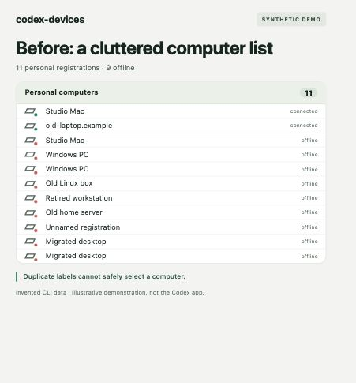
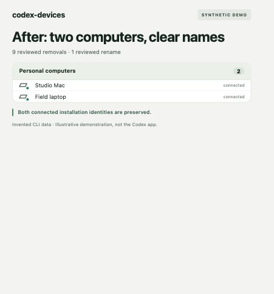

# codex-devices

A native macOS app and Rust command-line tool for investigating Codex computer lists:
old names, retired registrations, duplicate labels, and identities copied during
machine migration. The project develops a reviewed audit, backup, rename,
cleanup, and verification workflow for one person with several computers.

**Development preview:** the native macOS app provides discovery, SSH inspection,
name comparison and reviewed name-only repair through an experimental internal
API. The macOS CLI also supports explicit account-label repair without SSH.
The workflow has synthetic tests; reusable CLI and native-app live acceptance
remain separate checks. Offline demos use invented data and a local simulation.
Live cleanup is not implemented. This project is independent of OpenAI.

## macOS CLI: repair a known computer label

Run this from one Mac signed into the relevant Codex account. Editing an
already identified registration's label does not require SSH or the other
Mac's password. Network inspection is a separate operation for learning its
current system name. This command does not discover or change system names.

Build the native account transport and Rust verification engine together:

```sh
./script/build_cli.sh
./dist/codex-devices-mac --help
./dist/codex-devices-mac audit
```

The audit reads all records returned by the complete account registry, including
offline entries. Copy the full environment ID of the exact personal computer
to rename. Equal labels can belong to different registrations. Audit output
contains private labels and identifiers; do not attach it to public issues.
Tokens and raw installation IDs are not printed.

Prepare one name change in a new private operation directory:

```sh
mkdir -m 700 "$HOME/.codex-devices-operations"
./dist/codex-devices-mac rename \
  --id FULL_ENVIRONMENT_ID --name 'Field laptop' \
  --out "$HOME/.codex-devices-operations/rename-01"
```

Preparation writes the exact before capture and plan in a new private wrapper;
it sends no rename request. Review the printed old/new labels and full ID, plus
the saved plan under `rename-01/engine/plan.json`. Keep its `plan_sha256`.
This is explicit registry-label selection, without a claim of fresh SSH inspection.
No installation ID is rotated. Replace `REVIEWED_HASH` with the reviewed digest:

```sh
./dist/codex-devices-mac apply \
  --operation "$HOME/.codex-devices-operations/rename-01" \
  --approve-plan-sha256 REVIEWED_HASH
./dist/codex-devices-mac verify \
  --operation "$HOME/.codex-devices-operations/rename-01" \
  --expected-plan-sha256 REVIEWED_HASH
```

Apply requires unchanged account and full registry metadata, durable intent,
a matching response identity/name, and fresh complete preservation readback.
Installation/environment IDs, permissions, attachments and unselected records
must stay unchanged. A recorded attempt is never sent again. Verify reads back
without another rename. A lost or mismatched response remains uncertain even
if the label appears correct; retain the entire operation for investigation.
The backup is metadata evidence and does not promise automatic rollback.

This uses an unsupported internal API and the existing desktop sign-in, with
refresh disabled. It does not log in, log out, read installation-identity files,
or delete registrations. Build and test commands do not access an account.
Cargo installation alone provides the Rust offline commands below; the native
macOS commands require both executables from `build_cli.sh` kept together.
Swift 5.9+, macOS 13+ and Rust are required. Use process-local `DEVELOPER_DIR`
as described below if standalone command-line tools are selected.

## Native macOS app

Build on macOS 13 or later with the Xcode command-line tools, Swift 5.9 or later,
and the Rust toolchain. No third-party Swift packages are required:

```sh
./script/build_and_run.sh --build-only
open 'dist/Codex Devices.app'
```

The bundle embeds the native interface, Rust verification engine and SSH
authentication helper. Normal use requires no pasted scripts or CLI installation
on each Mac. Run `./script/build_and_run.sh` to rebuild and launch; add `--demo`
for invented computers and injected account services with the real Rust engine.
The demo creates guarded temporary backups and performs no live service writes.
`--verify` checks process startup; it does not establish repair acceptance.
Close the staged app before `--build-only`; the script refuses to overwrite a
running executable. Normal rebuild-and-launch stops only this staged app.

1. Open the app. **Codex computers** loads the signed-in account's complete list,
   including offline entries. Nothing is selected automatically. Known account
   labels can be edited without SSH or the other Mac's password.
2. Select one personal registration and edit its **Proposed Codex label**.
   Cloud, unsupported and ambiguous records remain read only. An unchanged label
   proposes no action.
3. Choose **Prepare Backup & Review**. Check the exact current/proposed labels,
   registration, installation fingerprint and private backup location.
4. Confirm the review, then choose **Apply Reviewed Change**. The app uses the
   same guarded workflow as the native CLI. It sends no change before approval.
5. **Verified** requires the matching response identity/name and fresh complete
   readback preserving identities, permissions, attachments and unselected
   records. An uncertain result offers **Check Readback** without repeating the
   write. Saved reviews and pending operations can be recovered after restart.

To compare with a Mac's system name, use the optional **Find Macs** tab and choose
**Scan Network**. Discovery uses Bonjour, an existing Tailscale installation and
an optional hostname. **Inspect** confirms the exact target and account first.
Remote inspection uses existing SSH access and explicit host-key trust; changed
keys refuse. Its secure prompt distinguishes that remote account's password
from a local SSH key passphrase. Local inspection uses the current Mac account.
An unambiguous match can copy the literal system name into the account editor;
the same backup and name review still follow. No network inspection starts
automatically, and custom labels are not rewritten automatically.

Private backups and operation journals are retained under
`~/Library/Application Support/Codex Devices/AccountOperations`. Each review
contains a wrapper folder with `engine/before.json`, `engine/plan.json`, a journal
and response evidence. The private `last-review.json` pointer supports recovery;
unknown or invalid saved state blocks new preparation. Keep the complete folder
if an operation stops. SSH trust remains under the separate `Operations/ssh`
folder. Passwords are never saved. Existing Codex sign-in is used without login,
logout or forced refresh. No installation ID is rotated or stale entry deleted.

The internal API is unsupported and can change. Root-page continuation assumes a
`cursor` query parameter and has only synthetic coverage. A successful build, fixture run
or app launch does not establish live SSH, account or repair compatibility. Native
window and live repair acceptance remain separately qualified. Native tests use
invented providers, explicit temporary paths and the built Rust engine. XCTest
requires full Xcode. If standalone command-line tools are selected, choose Xcode
for this invocation only:

```sh
cargo build --locked --release
DEVELOPER_DIR=/Applications/Xcode.app/Contents/Developer swift test --package-path macos
```

## The problem

A computer list can retain old registrations after migration or retirement.
Several entries can have the same name, and a healthy computer can retain an
outdated network name. A label alone cannot identify the record to change.
Changing an installation ID to fix a cosmetic name can create a separate
registration instead of repairing the existing one.

The screenshots show the intended outcome using fictitious machines:

| Before | After the synthetic workflow |
| --- | --- |
|  |  |

These are screenshots of a demonstration rendered from synthetic CLI results.
They contain no live account data and are not screenshots of the Codex app.
The after state demonstrates the local simulation, not a verified live repair.

## Install

You need Git and the Rust toolchain with Cargo. Install Rust from
[rustup](https://rustup.rs/) if needed. The manifest requires Rust 1.89 or newer;
use a current stable toolchain. macOS is the first supported development target.

Install from this repository:

```sh
cargo install --git \
  https://github.com/bobbypierce42/codex-devices \
  --branch main --locked
codex-devices --version
```

Or install a local checkout:

```sh
git clone https://github.com/bobbypierce42/codex-devices.git
cd codex-devices
cargo install --path . --locked
codex-devices --version
```

Cargo places the executable in its installation root's `bin` directory, normally
`~/.cargo/bin`. Add that directory to your shell's `PATH` if the command is not
found. Successful installation prints a version beginning `codex-devices 0.1.0`.
The `--locked` option uses the committed dependency versions. No daemon,
database, interpreter, or background service is required. There is no crates.io,
Homebrew, or prebuilt binary release.

## Try the offline demo

Audit the bundled fixture without opening an account or contacting a computer:

```sh
codex-devices audit --demo
codex-devices audit --demo --json
```

Expect eleven personal registrations: two connected and nine offline, plus a
separate cloud record. Equal names remain separate records. Candidate counts
authorize no changes. Use `--input FILE` instead of `--demo` for an explicit
synthetic schema-v1 catalog with `demo-` identifiers, such as
[the bundled fixture](fixtures/synthetic-catalog.json).

### Back up and verify

Create an output directory, then save a verified backup in a new destination:

```sh
mkdir -p demo-output
codex-devices backup --demo --out demo-output/backup --json
codex-devices verify --backup demo-output/backup --json
```

Keep the printed manifest digest separately. To verify against that trusted
value, replace `MANIFEST_HASH` with the printed digest:

```sh
codex-devices verify --backup demo-output/backup \
  --expected-manifest-sha256 MANIFEST_HASH --json
```

The destination must be new and its parent must already exist. The backup
preserves exact input bytes and checks its files by SHA-256 and readback.
Without the separate digest, verification checks internal consistency only.
A metadata backup does not establish that deleted registrations can be restored.

### Review a rename

Prepare a synthetic laptop rename using its full environment ID:

```sh
codex-devices rename --demo \
  --set 'demo-active-laptop=Field laptop' \
  --out demo-output/rename --json
```

Preparation creates a verified backup and review plan without applying changes.
Read `demo-output/rename/plan.json`, check the selected ID and exact name, and
retain its printed `plan_sha256`. Replace `REVIEWED_HASH` with that digest:

```sh
codex-devices rename --apply demo-output/rename \
  --approve-plan-sha256 REVIEWED_HASH --json
codex-devices verify --operation demo-output/rename \
  --expected-plan-sha256 REVIEWED_HASH --json
```

Only the operation's private `service.json` changes. The original input, backup,
installation IDs, environment IDs, and access grants stay guarded. Names are
trimmed, limited to 100 UTF-16 code units, and reject control characters. The
demo's rename permission is invented and does not qualify a service API.

### Prepare a name-only request proposal

An explicit operator capture can produce a private proposal for one existing
registration. The file uses the same schema-v1 paginated envelope as the fixture,
with `source.kind` set to `operator-snapshot`. This label is a provenance statement,
not authentication. Known IDs must be unique; all pages must be present. This
command never retrieves a capture, reads identity files, or contacts a service:

```sh
codex-devices rename --snapshot capture.json \
  --set 'FULL_ENVIRONMENT_ID=Field laptop' --out demo-output/name-proposal --json
codex-devices verify --name-proposal demo-output/name-proposal \
  --expected-plan-sha256 REVIEWED_HASH --json
```

Preparation saves exact `before.json` bytes and an anchored `plan.json` with the
existing installation ID and proposed custom name. The receipt exposes only the
installation fingerprint. The observed internal request contract is unqualified;
there is no live apply transport. Both commands return `4`, with
`apply_supported=false` and `live_state_verified=false`.

Add `--input after-capture.json` to verification to compare an explicit later
capture. Only the selected display name may differ; all other metadata, records,
IDs, access fields, and array order must remain unchanged. Matching supplied
captures does not prove live service state. Keep captures and proposals private.

### Review a cleanup

Prepare removal of two specific offline fixture records:

```sh
codex-devices cleanup --demo \
  --select demo-retired-01 --select demo-retired-02 \
  --out demo-output/cleanup --json
```

Review the plan and its automatic backup. Replace `REVIEWED_HASH` with this
cleanup plan's digest, then apply and verify:

```sh
codex-devices cleanup --apply demo-output/cleanup \
  --approve-plan-sha256 REVIEWED_HASH --json
codex-devices verify --operation demo-output/cleanup \
  --expected-plan-sha256 REVIEWED_HASH --json
```

Offline status alone never authorizes removal. Selection requires full IDs;
connected and unselected records remain protected. Each simulated action has
an intent, response, and readback in a locked operation journal.

If a rename or cleanup stops partway through, retain its directory and inspect
the reported reason. Replace `--apply` with `--resume`, using the same operation
path and approved digest. Resume reconciles existing results before another
request. Never erase a journal or lock file to force progress.

## Check a Mac's sign-in metadata

This opt-in diagnostic starts a temporary child of the installed desktop app's
bundled app server. It requests no tokens, forced refresh, sign-in/sign-out,
computer inventory, or registration changes:

```sh
codex-devices audit --local --json
```

Local discovery checks fixed paths in `/Applications/ChatGPT.app` and
`/Applications/Codex.app`. If both exist or your app is elsewhere, select its
bundled executable with `--app-server ABSOLUTE_EXECUTABLE`. The tool does not
search credential files or installation IDs. The app server controls its own
normal startup and logging.

For an explicitly selected Mac reachable through existing SSH or a tailnet,
replace `SSH_ALIAS` and `REMOTE_EXECUTABLE` with your trusted host alias and the
absolute path of its installed app-server executable:

```sh
codex-devices audit --peer SSH_ALIAS \
  --app-server REMOTE_EXECUTABLE --json
```

The remote mode needs no installation of codex-devices on the peer. It uses
system SSH, existing authentication, strict host-key checks, and batch mode.
It disables forwarding, local commands, key updates, and connection sharing.
User-configured SSH proxies remain trusted configuration. There is no host
enrollment, network scan, automatic app shutdown, or remote service installation.
Remote child termination is not guaranteed after a broken connection.

Output contains allowlisted mode/support metadata and target provenance, without
email, account IDs, credentials, or server messages. Responses have a 15-second
deadline, 64 KiB pending-buffer cap, and 1 MiB total cap. Unsupported methods,
unexpected server requests, or unexpected returned tokens stop the check.
Missing support or a non-ChatGPT mode returns partial/unknown. A successful
result proves metadata compatibility, not account identity or registry access.
See the [official app-server authentication documentation](https://learn.chatgpt.com/docs/app-server#auth-endpoints).

## Support and limits

The development scope is:

| Area | Status |
| --- | --- |
| Synthetic workflows | Tested on macOS ARM64 |
| Local sign-in diagnostic | Observed with bundled CLI `0.166.0-alpha.5.1` on one Mac |
| SSH diagnostic | Mock-tested; real peer execution remains unqualified |
| Name-only request proposals | Offline operator captures; live transport and capability unqualified |
| Native macOS account-label CLI | Explicit registry selection; synthetic transport/integrity tests; reusable live acceptance pending |
| Linux and Windows | Not qualified; Windows protected artifact operations refuse |
| Native macOS name-only repair | Experimental internal API; live acceptance separately required |
| Live cleanup, identity repair, plugin | Not implemented |

Input, encoded artifacts, journals, and JSON receipts are bounded to 4 MiB;
catalogs are limited to 4096 records. Private artifacts use owner/mode checks,
directory-relative file access, process locks, and conservative drift checks.
Inherited ACLs, hostile same-user races, and power-loss recovery remain limits.
Use trusted local storage. Rust offline verification uses supplied artifacts;
the macOS CLI's verify command reads the account registry without SSH. These
bounds do not define a total process memory or execution-time guarantee.

Exit codes are `0` success/preview, `1` I/O failure, `2` usage, `3` refusal,
`4` partial/unknown, and `5` integrity failure. JSON goes to stdout; failures go
to stderr. Large receipts can omit repeated review details while retaining all
outcomes, IDs, and digests; the receipt points back to their saved plan.

## Contribute

Read [CONTRIBUTING.md](CONTRIBUTING.md) for setup, checks, and pull requests.
Any editor or agent runtime is welcome. Use invented fixtures, keep changes
focused, and report security concerns through [SECURITY.md](SECURITY.md).

## License

[MIT](LICENSE). Dependency licenses and notices remain their respective owners'.
